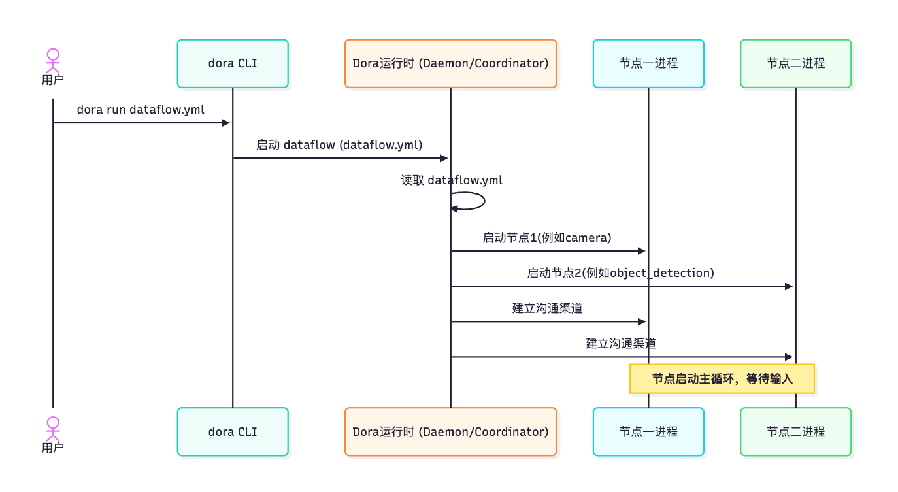
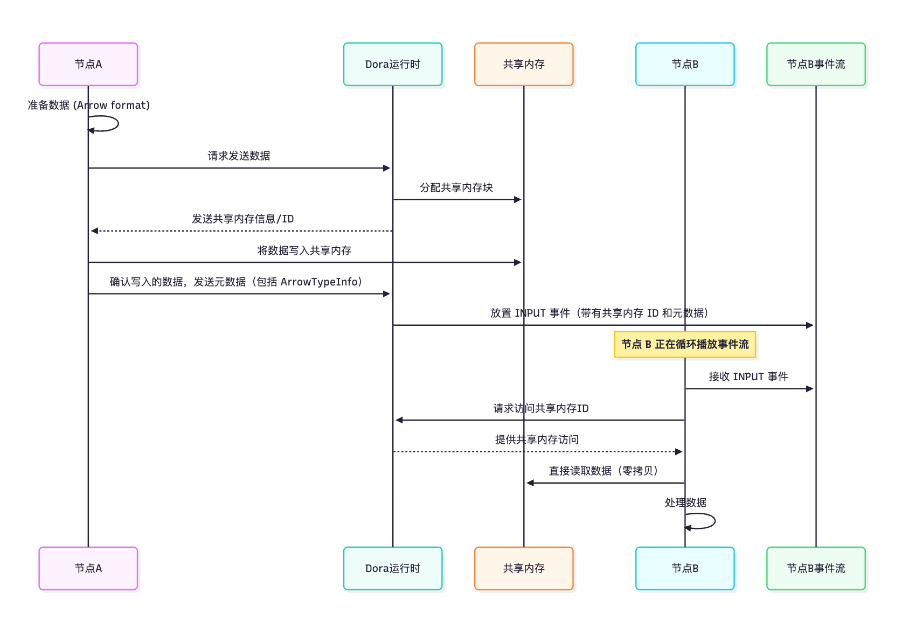
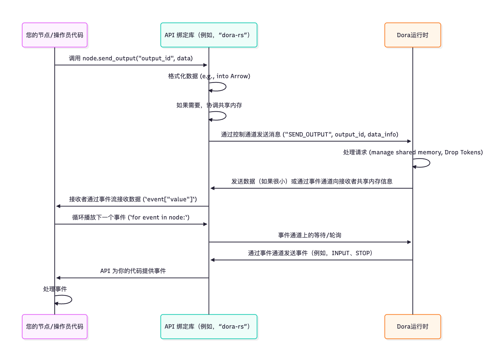
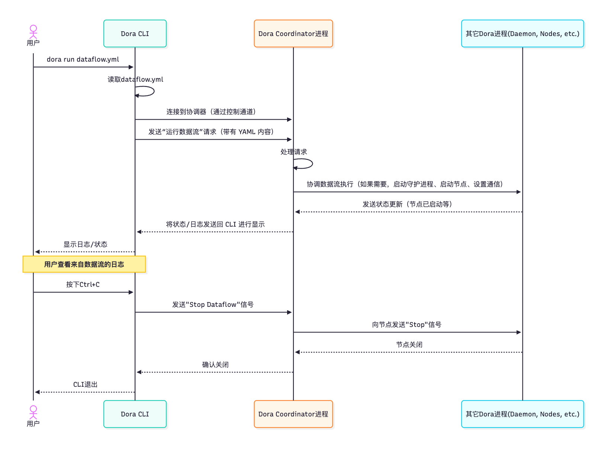
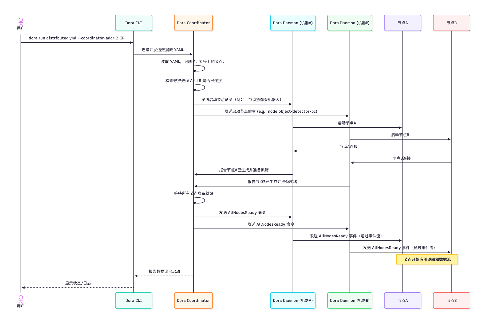

# dora-rs 学习文档
https://doracc.com/guide/tutorial/

# nodes 节点
https://doracc.com/guide/tutorial/node.html

节点是应用程序中一个独立的、自包含的工作单元。每个节点负责执行一项特定的任务。例如：

- 从传感器（如摄像头或麦克风）读取数据。
- 执行计算（如对象检测或过滤数据）。
- 控制硬件（如电机或灯）。
- 在屏幕上可视化数据。

其核心思想是每个节点都是独立的。它不需要知道前一个节点是如何工作的，只需要知道它产生了什么样的数据。同样，它也不需要知道谁会使用它的输出，只需要知道它自己产生了什么样的数据。

```yaml
nodes:
  # 定义相机节点
  - id: camera
    outputs:
      - image

  # 定义目标识别节点
  - id: object_detection
    inputs:
      image: camera/image
    outputs:
      - bbox

  # 定义可视化节点
  - id: plot
    inputs:
      image: camera/image
      bbox: object_detection/bbox
```

在此 YAML 中， nodes: 列表下的每个项目都定义一个节点：

- id ：这是数据流（ camera 、 object_detection 、 plot ）中节点的唯一名称。其他节点或 DORA 运行时可以通过此名称识别它。
- inputs ：列出了此节点需要接收的数据流。例如， object_detection 需要一个 image 输入。格式 source_node_id/source_output_id 指定哪个节点的输出流应该连接到此输入。这被称为“传入传送带”。
- outputs ：列出了此节点生成或发送的数据流。例如， camera 生成 image 输出。这被称为“输出传送带”。

YAML 中有关 Node 的其余信息（如 path 、 build 、 env ）告诉 DORA 如何运行该特定 Node 的实际代码。

# 节点作为独立进程
DORA 中节点的一个关键特性是它们通常作为单独的进程运行。分析一下当你使用 dora run your_dataflow.yml 的运行逻辑 ：

1. DORA 命令行界面（CLI）启动 dora 运行时（如 Dora Daemon 和 Dora Coordinator ）。
2. 运行时读取您的 Dataflow YAML 文件。
3. 对于 YAML 中定义的每个节点，运行时都会在您的计算机上启动一个新的独立进程。
4. 然后，运行时使用 YAML 中的 inputs 和 outputs 定义在这些单独的 Node 进程之间建立高效的通信通道（通常使用共享内存来提高速度）。

这种架构有几个优点：

- 隔离性： 如果一个节点崩溃（例如，由于其代码中的错误），通常不会影响其他节点。数据流可以继续运行或优雅地处理故障。
- 稳健性： 单独的流程可以更好地抵御某些类型的错误。
- 语言灵活性： 由于节点是通过标准机制进行通信的独立进程，因此您可以在同一数据流中使用不同的编程语言（Python 节点、Rust 节点、C/C++ 节点等）实现不同的节点。
- 可扩展性： 在更高级的场景中，这种架构可以更轻松地将节点分布在不同的 CPU 内核甚至不同的机器上。



一旦运行时设置了通信通道，节点就可以通过这些通道直接相互发送数据，而无需运行时代理每条消息。

节点是 DORA 数据流应用程序中独立的工作单元。它们在数据流 YAML 文件中定义，具有唯一的 ID、用于接收数据的特定输入以及用于生成数据的输出。每个节点都作为独立的进程运行，其内部逻辑（使用您选择的语言编写的 dora API）负责接收输入、执行任务和发送输出。Dora 运行时负责启动这些进程并根据 YAML 蓝图设置通信管道。

# Operator 算子
https://doracc.com/guide/tutorial/operator.html

Operator 是运行在 Dora Runtime 节点进程中的模块化逻辑。它们在 Dataflow YAML 的 Node 块中定义，允许您在单个节点内构建复杂的处理流水线。Operator 使用 Operator API 接收输入并发送输出， dora-runtime 负责加载它们、在它们之间建立内部通信，以及在节点的外部输入/输出和 Operator 的输入/输出之间路由数据。这提供了一种创建可复用处理步骤的方法。

# event stream 事件流处理
https://doracc.com/guide/tutorial/event-stream.html

事件流 是 DORA 中的一个基本概念。它是节点和算子接收其运行所需的所有信息的重要通信渠道，包括传入数据 ( INPUT )、输入源关闭信号 ( InputClosed ) 以及系统命令（ STOP 、 RELOAD ）。通过监听此事件流，您的节点和算子代码可以动态地响应数据流的状态。DORA 运行管理这些事件流，并根据数据流蓝图将事件传递给相应的节点和算子。

事件流中包含哪些类型的消息？
事件流不仅仅用于传入数据。它包含不同类型的消息， DORA 称之为 “事件” 。这些事件会告诉您的节点或算子数据流和系统中正在发生的事情。

以下是您通常会在信息流中发现的主要事件类型：

- INPUT： 这是最常见的事件。它表示新数据已到达节点（或算子）定义的某个输入。该事件将包含数据本身，并告知您数据来自哪个输入。这就是节点和算子接收需要处理的数据的方式。
- InputClosed： 此事件表示节点（或算子）的某个输入源已关闭或断开连接。如果正在为此输入生成数据的节点/算子完成其工作或崩溃，则可能会发生这种情况。您的代码可能需要对此做出反应，例如在关键输入丢失时优雅地关闭。
- STOP： 此事件是来自 dora 运行时的命令，告知 Node 或 Operator 关闭。当您使用 dora CLI 停止数据流，或者数据流自然结束时（例如，所有输入都关闭，没有其他工作要做）时，就会发生这种情况。您的代码应该监听此事件并干净地退出。
- RELOAD： 此事件表示节点或算子应重新加载其配置或逻辑（如果支持热重载）。这是一项高级功能，允许在不完全重启的情况下更改数据流。
- ERROR： 表示事件流本身发生了不可恢复的错误。

# 数据信息 和 Arrow Data

对速度的需求：处理大数据
再次想象一下我们的对象检测数据流：相机节点生成图像，对象检测节点处理它们，绘图节点将它们可视化。

- 图像通常很大（例如，具有 3 个颜色通道的 640x480 像素超过 900 KB）。
- 传感器数据（例如来自 LiDAR 传感器的点云）可以更大。
这些海量数据需要快速地从一个 Node 进程传输到另一个 Node 进程。如果 DORA 每次将图像从摄像头节点发送到物体检测节点，然后再发送到绘图节点时，都必须完整复制一份，这将浪费大量的时间和内存。这在毫秒必争的实时应用中尤其糟糕。

我们需要一种以最小的开销在进程之间共享或移动这些数据的方法。

在 DORA 中，当数据到达输入时，它是 INPUT 事件的一部分， DORA 实际的数据有效负载被包装在数据信息中。DORA 使用称为 Apache Arrow 的强大标准来表示大多数数据信息中的数据。

Apache Arrow 是一种高度优化、标准化的内存数据组织方式。Arrow 并非只是提供每个人都必须以不同方式解释的原始字节流，而是为数字列表、数组、表等常见数据类型提供了定义的结构。

为什么选择 Arrow？

- 标准化： 为跨不同编程语言和系统的数据提供通用语言。
- 性能： 它专为分析处理和数据传输而设计，特别是支持“零拷贝读取”。
- 零拷贝： 这是 DORA 的关键部分。如果数据位于共享内存中，并且格式为 Arrow，则多个进程可以从同一内存位置读取数据，而无需将数据复制到各自的地址空间中。

因此，当节点或算子接收到 INPUT 事件时，该事件的 value 部分通常是一个 Arrow 数组 （有时是一个包含多个 Arrow 数组的结构体）。Arrow 数组是 Arrow 术语，指一系列相同类型的值（例如整数列表、浮点数列表或表示图像的字节列表）。

# dora 底层：共享内存和零拷贝
DORA 如何实现性能提升，尤其是“零拷贝”？

对于较大的数据有效载荷（超过一定的大小阈值，由核心代码中的 ZERO_COPY_THRESHOLD 定义，当前为 4KB）， DORA 使用共享内存 。

以下是 节点A 向 节点B 发送大数据信息时的简化流程：

1. 节点 A 以 Apache Arrow 格式准备数据。
2. 节点 A 告诉 dora 运行时（通过控制通道）它想要在特定的输出上发送该数据。
3. dora 运行时分配了一块共享内存。这块内存节点 A 和节点 B 进程都可以访问。
4. 节点 A 将 Arrow 格式的数据写入此共享内存块。
5. 然后， dora 运行时向节点 B 发送一个 INPUT 事件。此事件不包含数据本身，而是包含数据所在的共享内存块的引用或标识符 ，以及 Arrow 结构信息（类型、大小、布局）， DORA 其称为 ArrowTypeInfo ，是消息 Metadata 的一部分。
6. 节点 B 收到 INPUT 事件，从 Metadata 中读取共享内存标识符和 ArrowTypeInfo 。
7. 节点 B 使用其 dora API 访问数据。该 API 知道如何将共享内存块映射（使其可访问）到节点 B 的进程中，并使用 Arrow 格式信息直接从那里读取数据。

这是一个简化的序列图：


这种从共享内存直接读取（“零拷贝”）的方式使得 DORA 能够快速传输大量数据信息，因为数据本身不需要序列化、通过管道发送，也不需要由接收进程反序列化。

对于小数据有效载荷（低于 ZERO_COPY_THRESHOLD ），数据可能会直接在消息本身内发送（例如，通过通信管道复制），因为设置共享内存的开销可能大于复制小数据的成本。

# 管理共享内存：删除令牌
共享内存的一个关键挑战是知道何时可以安全地释放内存。如果发送节点过早释放内存，接收节点在尝试访问时可能会崩溃。 DORA 使用一种涉及丢弃令牌的机制来管理这个问题。

1. 当节点 A 使用共享内存发送数据时，它会为该特定的共享内存块生成一个唯一的 DropToken 。
2. dora 运行时指出，节点 B（和任何其他订阅者）在处理完数据后需要得到通知。
3. 节点 A 跟踪它生成的 DropToken 。
4. 当节点 B 接收到数据并完成处理时（例如，当接收到的数据对象超出其代码范围时），节点 B 中的 dora API 会向运行时发回信号，表明它已完成与该共享内存 ID/Drop Token 相对应的数据处理。
5. dora 运行时会跟踪有多少节点接收了数据。当所有接收该特定数据块的节点都发出完成信号后，运行时会通过一个称为 Drop Stream 的专用内部通道，向原始发送节点（节点 A）发送 drop token 完成”信号。
6. 节点 A 监听这些“drop token 完成”信号（由 dora Node API 内部处理）。当节点 A 收到它之前发送的 DropToken 信号时，它就知道特定的共享内存块不再被任何下游节点需要，可以安全地释放或返回到缓存中以供重用。

此 Drop Token 机制确保仅在所有预期接收者完成访问后才回收共享内存。

为了实现高性能，尤其是在处理大数据量时， DORA 主要使用 Apache Arrow 格式，并利用共享内存在进程间实现零拷贝数据传输。这意味着接收节点可以直接从发送节点写入的同一内存位置读取数据。Drop Token 机制确保此共享内存得到安全管理，并且仅在所有接收节点都处理完数据后才会释放。理解这些概念是理解 DORA 在实时数据管道中性能特征的关键。

# 代码的翻译器和工具包
假设你用 Python 设计了一个很棒的物体检测算法。你想把它包装在一个 DORA 节点中，这样它就可以从摄像头节点接收图像，并将检测结果发送到绘图节点，所有这些都按照你的 Dataflow YAML 文件中的定义进行。

您的 Python 代码需要特定的工具来：

1. 告诉 DORA 运行时它已准备好启动。
2. 监听来自事件流的传入 INPUT 事件。
3. 从事件中提取实际图像数据消息。
4. 将计算出的边界框数据作为新的数据消息发送回运行时，并指定它应该转到哪个输出。
5. 如果 DORA 运行时发送了 STOP 信号，则知道何时停止。

这些工具以库或模块的形式提供给不同的编程语言，它们被称为 API 绑定 。它们是连接自定义应用程序逻辑和 dora 运行时环境的软件层。

将 API 绑定视为：

- 翻译器： 它们将代码中的高级指令（如“发送此数据”）转换为 DORA 运行时可以理解的低级消息和协议。
- 工具包： 它们提供现成的功能和结构（ send_output 、 next 、 on_event 等），简化与 DORA 核心机制（如事件流和数据消息处理）的交互。

DORA 为多种语言提供了 API 绑定，包括 Rust、Python、C 和 C++。因此，您可以在同一个数据流中混合搭配使用不同语言编写的节点，只要它们使用各自语言的 dora API 绑定进行通信即可。

# API 绑定提供的核心功能
无论使用哪种语言， dora API 绑定通常都会提供用于以下基本任务的函数或方法：

1. 初始化： 用于将 Node/Operator 代码连接到正在运行的 DORA 数据流实例的函数。此步骤对于运行时识别组件并设置其通信通道至关重要。
2. 接收事件： 监听并从组件的事件流中获取事件的机制。正如我们所见，这通常涉及一个循环或一个回调函数来处理传入的事件（ INPUT 、 STOP 、 InputClosed 等）。
3. 发送输出数据： 用于在组件的输出流上发布数据的函数。您可以指定要发送数据的输出 ID，并提供数据负载（通常使用 Apache Arrow 进行结构化）。
4. 访问数据/元数据： 辅助函数可轻松访问 INPUT 事件中包含的数据（ event["value"] ）和可选 metadata （ event["metadata"] ）。
5. 处理控制信号： 针对 STOP 等控制事件的内置处理或清晰的通知机制。

# 底层：与运行时交互的 API 绑定
那么，当您调用 node.send_output(...) 或 send_output(...) 时会发生什么？

API 绑定库本身并不实现整个 DORA 通信逻辑。相反，它与启动节点或操作员的 DORA 运行时进程（ Dora Daemon/Coordinator ）进行通信。

当你的 Node/Operator 进程启动时， dora 运行时会设置高效的通信渠道：

1. 事件通道： 这是 dora 运行时向你的 Node/Operator 发送事件的地方（即事件流 ）。API 绑定的事件循环（ for event in node ）正在监听此通道。
2. 控制通道： 这是你的节点/操作员向 dora 运行时发送命令的地方（例如“发送此输出”、“我已完成此共享内存块的操作”）。API 绑定的 send_output 函数使用此通道。
3. 共享内存： 对于大数据，数据本身通过共享内存传输，并通过控制通道上的消息进行协调。

这是一个简化的序列图：


API 绑定 隐藏了这些通道和协议的复杂性，让您可以专注于应用程序逻辑。它将您语言的数据类型转换为适合 DORA 的格式（例如 Arrow ），并管理高效通信所需的低级交互。

Rust 和 C++ API 绑定通常会暴露底层细节或允许更细粒度的控制以提高性能，而 Python 绑定则优先考虑易用性。但它们的根本目的都是为你的自定义代码提供一种结构化的方式，以便与 DORA 运行时进行通信。

API 绑定是必不可少的软件库，它使您能够使用熟悉的编程语言（例如 Python、Rust、C 和 C++）为自定义 DORA 节点和算子编写核心逻辑。它们提供了标准化的函数工具包（ init 、 send_output 、事件循环/回调），这些函数抽象了进程间通信、共享内存和事件处理的复杂性，使您可以专注于特定的应用程序任务，同时无缝集成到 DORA 数据流中。

# CLI 的工作原理
需要注意的是， dora CLI 工具（ DORA 可执行文件） 并非 dora 运行时本身。 dora 运行时由一个或多个后台进程组成，通常包括 Dora Daemon 和 Dora Coordinator。

当你输入像 dora run yolo.yml 这样的命令时：

1. dora CLI 程序启动。
2. 它读取 yolo.yml 文件。
3. 然后它连接到正在运行的 DORA 运行时（具体来说，它与 Dora Coordinator 对话）。
4. CLI 向协调器发送一条消息或请求，说“请运行此 YAML 描述的数据流”。
5. 协调器接收请求，然后协调数据流的实际运行（启动节点进程、建立通信等）。

CLI 本质上是一个向 dora 运行时服务器进程发送命令的客户端应用程序。

以下是 dora run 交互的简化视图：


这表明 CLI 本身并不运行你的 Nodes ；它将这项任务委托给 Coordinator 和其他运行时组件。这种架构允许运行时在后台管理数据流，即使 CLI 处于关闭状态。

演示流程
```shell
dora up
dora start dataflow.yml
dora list # 查看运行节点列表
dora status # 查看dora状态
dora top # 查看进程运行情况
```

Dora CLI 是您与 DORA 系统交互的主要工具。您可以使用简单的命令，例如 dora run 根据 Dataflow YAML 蓝图启动数据流，使用 dora build 准备依赖项，以及使用 dora stop 和 dora list 管理正在运行的应用程序。CLI 充当命令接口，与 dora 运行时进程（例如 Dora Coordinator ）通信，告诉它们执行操作，而不是直接运行数据流。

# dora 守护进程
当您使用 Dora CLI 运行类似 dora run 命令时，实际上是在告诉 DORA 执行您的数据流。但是，CLI 程序本身并不是运行节点和管理所有复杂通信的程序。 这项工作落到了构成 DORA 运行时的后台进程身上。

这些后台进程中最重要的一个，尤其是在单机上运行的 Dora Daemon 守护进程 就是它。

Dora Daemon 它是一个运行在机器上的后台服务，负责管理特定机器上的 DORA 组件。

其主要职责是：

- 启动节点： 根据 Dataflow YAML 启动分配给其机器的节点进程。
- 管理本地通信： 设置并处理在同一台机器上启动的节点之间的高性能通信通道（例如共享内存 ）。这对于速度至关重要！
- 接收指令： 从 Dora CLI （在简单的本地设置中）或 Dora Coordinator （在分布式设置中）获取命令。
- 监控节点： 跟踪其管理的节点的健康和状态。
- 处理流量： 确保在本地节点之间移动的数据高效地到达正确的目标输入。在分布式设置中，它还有助于将数据路由到其他机器或从其他机器路由回来。

## 分布式数据流中的 dora 守护进程
在更复杂的设置中，您的数据流跨越多台机器，您将在每台承载 DORA 节点的机器上运行一个 DORA 守护进程 。此外，还会有一个 Dora 协调器来管理这些机器上的整体数据流。

在这种情况下：

1. Dora CLI （通常）与 Dora 协调器 （ dora start yolo.yml --coordinator-addr ... ）对话。
2. 协调器根据 YAML 中的 _unstable_deploy: machine 字段确定哪些节点在哪台机器上运行。
3. 协调器指示相关的守护进程 （每台机器上一个）启动分配给其机器的节点。
4. 然后，其各自机器上的每个守护进程执行如上所述的相同的本地管理任务：启动其指定的节点，在这些本地节点之间设置本地通信通道（如共享内存）并监视它们。
5. 对于不同机器上的节点之间的数据流动，守护进程会相互通信并与协调器（通常使用 Zenoh，如 README 中所述）进行通信，以确保数据在网络中路由。然而，守护进程的核心职责仍然是在其机器上本地管理 DORA 环境。

# Dora Daemon 内部
Dora Daemon 作为单个后台进程运行（您经常可以在系统的进程列表中看到它）。它主要用 Rust 编写，以提高性能和可靠性。

其内部运作的关键方面包括：

- 通信通道： 它使用操作系统提供的各种高效的进程间通信 (IPC) 机制与其启动的 Node 进程进行通信。这些通道是在 Node 使用 API 绑定连接到守护进程时建立的。
- 共享内存管理： 守护进程负责分配和释放用于本地节点之间大数据消息的共享内存区域。它与丢弃令牌机制配合使用，在节点处理完共享内存块后接收通知，以便安全地重用或释放该内存块。
- 事件循环： 与节点和算子类似，守护进程拥有自己的内部事件循环。它监听不同类型的事件：
- 来自 Dora CLI 或 Dora Coordinator 的命令（例如，启动数据流、停止数据流、获取日志）。
- 来自 Node 进程的请求（例如，“我想发送数据”、“我正在订阅我的事件流”、“我已完成此 Drop Token”）。
- 来自操作系统的事件（例如，Node 进程已退出）。
- 与远程通信相关的事件（例如，通过 Zenoh 从另一台机器上的守护进程接收数据）。
- 状态管理： 它跟踪哪些数据流在其机器上运行，哪些节点属于哪个数据流，每个节点的状态（运行、停止等）以及本地通信的输入/输出映射。

你可以在 dora-daemon 包中找到守护进程的主要逻辑，具体位置为 binaries/daemon/src/lib.rs 。此文件包含核心 Daemon 结构体及其 run_inner 方法，该方法实现了主事件循环，用于处理来自 CLI/Coordinator、Node 进程和其他来源的事件。

守护进程与 Node 进程之间的通信由 DaemonRequest （从 Node 到守护进程）和 DaemonReply / NodeEvent / NodeDropEvent （从守护进程到 Node）等消息定义，您可以在 libraries/message/src/node_to_daemon.rs 和 libraries/message/src/daemon_to_node.rs 文件中看到这些消息。每种语言的 API 绑定都封装了这些消息和底层通信通道。

Dora Daemon 是 DORA 运行时的关键组件。它充当机器上的本地管理器，负责启动和监控分配给它的 Node 进程，最重要的是，它基于 Dataflow YAML 建立和管理它们之间高效的本地通信通道（例如共享内存） 。它接收来自 Dora CLI 或 Dora Coordinator 的指令，并确保数据流量在其本地机器上正确流动。

# Dora Coordinator 协调器
当你的应用程序变得更大，需要使用分布在多台计算机上的传感器、处理器或硬件时，会发生什么情况呢？例如，你可能会遇到：

- 一个机器人上的一个摄像头。
- 在强大的台式计算机上运行的重型 AI 模型。
- 另一块硬件上的电机控制器。
- 笔记本电脑上的可视化显示。

您的 Dataflow 需要跨越所有这些机器。您将在每台机器上运行一个 Dora Daemon 来管理本地节点 。但是，如何让系统在正确的机器上启动正确的节点 ，协调它们之间通过网络的通信，并管理这个分布式应用程序的整个生命周期呢？

这就是 Dora Coordinator 协调器 的工作。

其主要职责是：

1. 接收命令： 它从 Dora CLI 接收有关整个数据流的指令（例如“启动此数据流”、“停止该数据流”）。
2. 了解景观： 它跟踪不同机器上可用的 Dora Daemons 。
3. 数据流编排： 它读取数据流 YAML ，了解哪些节点需要在哪台机器上运行（如果指定），并告诉适当的 DORA 守护进程启动这些节点 。
4. 管理生命周期： 它管理数据流的整体状态（运行、停止等）并协调跨多台机器停止或重新加载节点等命令。
5. 协调通信（高级）： 守护进程处理本地数据传输（如共享内存 ）时，协调器确保底层传输（如 Zenoh，通常用于分布式设置）配置正确，以便数据可以按照数据流蓝图在不同机器上的守护进程之间流动。

本质上，协调器是连接用户（通过 CLI）和守护进程和节点的分布式集合的大脑。

## 协调器是如何工作的
DORA 协调器作为独立、专用的后台进程运行。其主要目标是维护跨多台机器的 DORA 系统的全局视图。

- 通信： 它通过 TCP/IP 与 DORA 守护进程通信。守护进程启动时会连接到协调器。
- 状态管理： 它保存正在运行的数据流的整体状态，包括哪些节点属于哪个数据流以及每个节点被分配到哪个守护进程/机器。
- 事件循环： 与其他 DORA 组件一样，Coordinator 也有一个事件循环。它会等待并处理不同的事件：新的守护进程连接。
- 来自 Dora CLI 的请求（例如， Start 、 Stop 、 List 、 Build 、 Logs 、 Destroy ）。
- 来自守护进程的消息（例如，“我的守护进程 ID 是......”，“数据流 X 已完成结果......”，“我的机器上的节点 Y 在订阅之前退出”）。
- 内部事件（如心跳定时器，用于检查守护进程是否仍然活跃）。
- 编排逻辑： 当它收到数据流的 Start 等命令时：
- 它解析 YAML 来了解节点部署。
- 它检查其连接的守护进程列表，以查看所需的机器是否可用。
- 然后，它将特定的 DaemonCoordinatorEvent 消息（如 Spawn(SpawnDataflowNodes) ）发送给相关的守护进程，告诉每个守护进程它负责为这个特定的数据流启动哪些节点。
- 它跟踪来自守护进程的回复（ DaemonCoordinatorReply ）以确认节点已成功生成或构建（ DataflowSpawnResult ， DataflowBuildResult ）。
- 一旦所有需要的节点在各自的守护进程上报告准备就绪，协调器就会向所有涉及的守护进程发送 AllNodesReady 事件，节点可以使用该事件（例如开始发送数据）。
- 当它收到 Stop 命令时，它会向所有涉及的守护进程发送 StopDataflow 事件。

下面是一个简化的序列图，说明如何启动分布式数据流：


这表明协调器充当着协调分布式守护进程动作的中心点。

您可以在 dora-coordinator 包 ( binaries/coordinator/src/lib.rs ) 中找到 Dora Coordinator 的核心实现。该文件包含 start 函数，该函数用于设置传入连接（来自守护进程和 CLI 控制平面）的监听器，以及处理不同事件类型（ Event::NewDaemonConnection 、 Event::Control 、 Event::Daemon 等）的主异步循环 ( start_inner )。

协调器与守护进程之间交换的消息（例如 DaemonCoordinatorEvent 和 DaemonCoordinatorReply ）定义在 libraries/message/src/coordinator_to_daemon.rs 和 libraries/message/src/daemon_to_coordinator.rs 中。CLI 命令定义在 libraries/message/src/cli_to_coordinator.rs 中。协调器的事件循环接收这些消息并触发相应的操作。

Dora Coordinator 是 DORA 系统的中央编排器和指挥中心，对于管理分布在多台机器上的数据流至关重要。它接收来自 Dora CLI 的指令，跟踪可用的 Dora Daemons ，并根据数据流 YAML 蓝图协调在正确的机器上启动、停止和管理节点 。通过监督分布式系统，它使您能够无缝构建和管理复杂的多机器应用程序。

# 实战文档
https://doracc.com/course/intro/index.html
